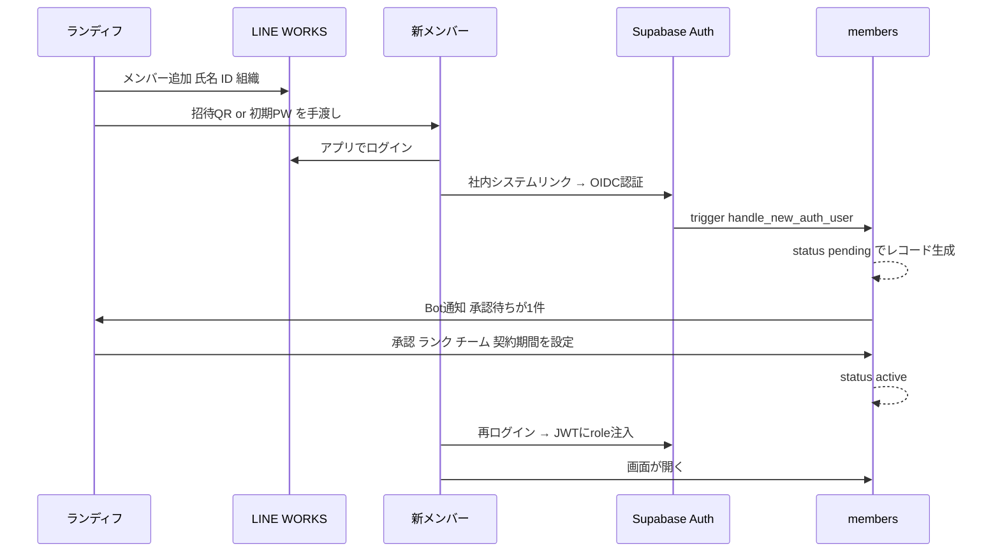
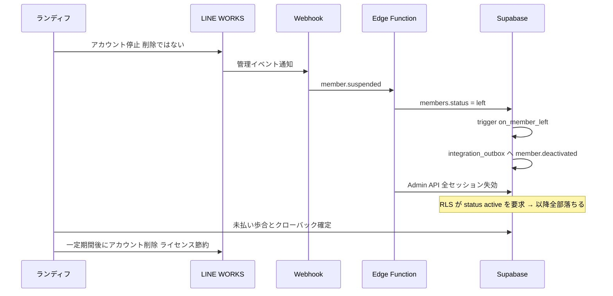

# ICHIYO 社内システム / 運用フロー（入社・日常管理・退職）

スキーマ定義は [`docs/schema.md`](schema.md) を参照。本書はアカウントのライフサイクル（発行 → 日常管理 → 退職）がシステムにどう反映されるかを扱う。

---

## 1. 入社（アカウント発行）

**システム上の実装**

- トリガー `on_auth_user_created` → `handle_new_auth_user()`
- `lw_user_id` を UNIQUE キーにして、`sub` だけに依存しない
- 再入社時は既存 `members` レコードに `auth_user_id` を再紐付け（`update ... where lw_user_id = ? and auth_user_id is null`）
- pending の間は `auth_is_active()` が false → **全 RLS ポリシーが落ちる**ので何も見えない

---

## 2. 日常管理

| 事象 | 触る場所 | テーブル |
|---|---|---|
| パスワード忘れ | LINE WORKS のみ | なし |
| 昇降格 | 社内システム | `rank_history` に新レコード（`exclude using gist` で期間重複を DB が拒否） |
| チーム異動 | 社内システム + LINE WORKS 組織 | `members.team_id` |
| エリア担当変更 | 社内システム | `area_assignments`（期間つき） |
| 権限昇格 | 社内システム（sysadmin のみ） | `members.role` → 次回トークン更新で反映 |

**日次同期バッチ（深夜）**

- LINE WORKS Directory API で全メンバーを取得
- `members.lw_user_id` と突合 → 差分を `lw_sync_logs` に記録
- **自動削除はしない**。差分があればランディフさんに LINE WORKS Bot で通知
- ログイン時にも LINE WORKS 側の在籍を確認（バッチの隙間24時間を埋める）

---

## 3. 退職

**絶対に守ること**

- `members` のレコードは**物理削除しない**。`status = 'left'` の論理削除
- 理由1: 過去の成約・売上・歩合が FK で紐付いている（`deals.rep_id` は `on delete restrict`）
- 理由2: freee に送った仕訳と照合できなくなる
- 理由3: 労基法109条 労働者名簿・賃金台帳の保存義務（退職後3年）
- 理由4: 退職後にクーリングオフ → クローバックが発生しうる

**Webhook が取れない場合の保険**

- JWT の有効期限を1時間に短縮
- リフレッシュ時に LINE WORKS 側の在籍を確認するミドルウェアを Next.js に置く
