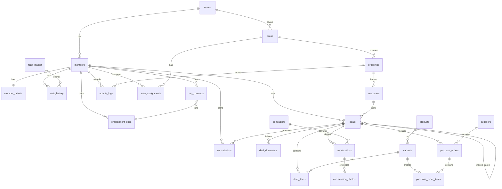

# ICHIYO 社内システム / Supabase スキーマ設計書

- 作成日: 2026-07-18
- 対象: 一陽株式会社 社内システム
- 前提: Supabase Pro plan（Custom OIDC Provider = LINE WORKS）
- 実体定義: [`supabase/migrations/20260718000000_init.sql`](../supabase/migrations/20260718000000_init.sql)
- 運用フロー（入社・日常管理・退職）: **[`docs/ops.md`](ops.md)** に分離

---

## 1. 設計の前提

| 項目 | 内容 |
|---|---|
| 認証 | LINE WORKS（Custom OIDC）。管理者2名のみ email+password のバックドアを保持 |
| 権限 | JWT カスタムクレーム（`app_role` / `member_id` / `member_status`）で RLS を駆動 |
| 人の台帳の正 | LINE WORKS |
| 給与・ランク・成績の正 | Supabase |
| 会計・給与の確定 | freee会計 / freee人事労務（Outbox 経由） |

**再帰RLSの回避**: `members` テーブルの `role` カラムを RLS 内で参照すると、`members` のポリシー評価がまた `members` を読みに行って無限再帰する。これを避けるため、role は JWT クレームから読む（`auth_role()` 関数）。

---

## 2. テーブル一覧（全30テーブル + 1ビュー）

| # | テーブル | 役割 | RLS の骨子 |
|---|---|---|---|
| 1 | `teams` | チーム（西条/新居浜） | 全員読み / 管理者書き |
| 2 | `members` | 公開情報（氏名・ランク・チーム） | **全員が全員を読める** |
| 3 | `member_private` | 個人情報（住所・口座・生年月日） | 本人 + sysadmin + director |
| 4 | `rank_master` | ランク×職種の単価表 | 全員読み（賃金規程で公開済） |
| 5 | `rank_history` | 昇降格履歴（不変・期間重複禁止） | 本人 + 管理者 |
| 6 | `rep_contracts` | 雇用契約期間・給与上書き | 本人 + 管理者 |
| 7 | `properties` | 顧客宅（緯度経度・訪問状態） | 全員 |
| 8 | `areas` | エリアポリゴン | 全員 |
| 9 | `area_assignments` | エリア担当（期間つき・重複禁止） | 全員 |
| 10 | `customers` | 顧客（世帯） | 全員 |
| 11 | `products` | 製品ライン | 全員 |
| 12 | `variants` | 型番・スペック・価格 | 全員 |
| 13 | `deals` | 案件・契約 | 読み全員 / 書き担当本人 or 管理者 |
| 14 | `deal_items` | 案件明細（価格スナップショット） | 全員 |
| 15 | `deal_documents` | 書面交付チェック（特商法） | 全員 |
| 16 | `contractors` | 施工業者 | 全員 |
| 17 | `constructions` | 工事・検収 | 全員 |
| 18 | `construction_photos` | 現場写真 | 全員 |
| 19 | `suppliers` | 仕入先 | 管理者のみ |
| 20 | `purchase_orders` | 発注 | 管理者のみ |
| 21 | `purchase_order_items` | 発注明細 | 管理者のみ |
| 22 | `activity_logs` | 訪問・アポ・成約ログ | 読み全員 / 書き本人 |
| 23 | `commissions` | 歩合（クローバックは負値） | 本人 + 管理者 |
| 24 | `policy_docs` | 就業規則・賃金規程 | 全員 |
| 25 | `employment_docs` | 雇用契約書（個別） | 本人 + 管理者 |
| 26 | `doc_access_logs` | 書類閲覧の証跡 | 読み管理者 / 書き本人 |
| 27 | `social_posts` | 自社SNS投稿 | 全員 |
| 28 | `integration_outbox` | freee/Auth 連携キュー | sysadmin |
| 29 | `lw_sync_logs` | LINE WORKS 同期ログ | sysadmin |
| 30 | `audit_logs` | 監査 | sysadmin |
| — | `v_member_performance` | 成績ランキング（ビュー） | 全員 |

---

## 3. リレーション図



---

## 4. アカウント発行 → 退職 の運用フロー

入社・日常管理・退職のシステム反映フロー（シーケンス図つき）は **[`docs/ops.md`](ops.md)** に分離しています。

---

## 5. 制約で守っている業務ルール

DB レベルで強制しているもの。アプリのバグでは破れない。

| 制約 | テーブル | 内容 |
|---|---|---|
| `exclude using gist` | `rank_history` | 同一メンバーのランク期間が重複しない |
| `exclude using gist` | `rep_contracts` | 同一メンバーの契約期間が重複しない |
| `exclude using gist` | `area_assignments` | 同一エリア×同一メンバーの担当期間が重複しない |
| `stage1_loan_cap` | `deals` | Stage1 のローンが500万を超えない |
| `clawback_is_negative` | `commissions` | クローバックは必ず負値 |
| `left_requires_date` | `members` | status=left なら left_on 必須 |
| `unique idempotency_key` | `integration_outbox` | freee への二重送信を防ぐ |
| `unique (deal_id, doc_kind)` | `deal_documents` | 同じ書面を二重交付登録しない |
| `on delete restrict` | `deals.rep_id` | 成約のある人を消せない |
| `cooling_off_end` generated | `deals` | 起算日+8日を DB が自動計算（ハードコード禁止） |

---

## 6. 自動化されている業務フロー（トリガー）

| トリガー | 発火条件 | 動作 |
|---|---|---|
| `deals_inspected` | `inspected_on` が null → 値あり | `status = recognized`、Outbox に freee 仕訳を積む |
| `deals_cancelled` | `status` → `cancelled` | 支払済み歩合を集計 → `commissions` に負値レコードを自動生成 |
| `members_left` | `status` → `left` / `suspended` | Outbox に `member.deactivated` を積む（Edge Function がセッション失効） |
| `on_auth_user_created` | `auth.users` に insert | `members` を pending で生成 or 既存に紐付け |
| `custom_access_token_hook` | ログイン・トークン更新のたび | JWT に `app_role` / `member_id` / `member_status` を注入 |
| `touch_updated_at` | update 全般 | `updated_at` を自動更新 |

---

## 7. Storage の設計

| バケット | パス | RLS |
|---|---|---|
| `policy` | `policy/{doc_id}.pdf` | 全 active メンバー読み取り可 |
| `employment` | `employment/{member_id}/{doc_id}.pdf` | 本人 + sysadmin + director |
| `construction` | `construction/{deal_id}/{photo_id}.jpg` | 全 active メンバー |
| `social` | `social/{post_id}/*` | 全 active メンバー |

Storage のポリシーは `storage.objects` に対して、パスの第2要素（`(storage.foldername(name))[2]`）を `auth_member_id()` と突合する形で書く。

---

## 8. 残論点

- **LINE WORKS Webhook の対応範囲**: 管理イベント（メンバー停止・削除）の通知が実際に取れるかは Developer Console で要確認。取れないなら日次バッチ + 短い JWT 有効期限で代替
- **freee 人事労務の従業員マスタ**: LINE WORKS / Supabase / freee の3箇所に人がいる。freee への登録・退職処理は**手動で残す方が安全**（給与誤支給は取り返しがつかない）。`member_private.freee_employee_id` は紐付け用に持つだけ
- **歩合の締め日**: `commissions.target_month` を「成約日基準」にするか「検収完了日基準」にするかは契約条件そのもの。先に確定が必要。現状のスキーマはどちらでも入る
- **`v_member_performance` の重さ**: 人数と案件が増えると集計が遅くなる。Materialized View + 日次リフレッシュへの切り替えを想定しておく
- **pending 放置の事故**: 承認忘れで新人が入れない。24時間放置で Bot 通知する仕組みが要る
- **監査ログの自動化**: `audit_logs` テーブルは定義したが、書き込みトリガーは未実装。対象テーブルを絞ってから足す（全テーブルに掛けると重い）
- **Custom OIDC は Pro plan（$25/月〜）必須**: 無料版で先に試すなら、自前で認可コードフロー → `signInWithIdToken` の方式に一旦倒す

---

## 9. 適用手順

```bash
# ローカルで検証
supabase db reset
supabase db push

# Custom Access Token Hook の有効化
# Dashboard → Authentication → Hooks → Customize Access Token (JWT) Claims
#   → public.custom_access_token_hook を選択

# Custom OIDC Provider の登録
# Dashboard → Authentication → Providers → Add provider → OIDC
#   Issuer: https://auth.worksmobile.com/oauth2/v2.0
#   Client ID / Secret: LINE WORKS Developer Console で取得
#   Redirect URI: https://<project>.supabase.co/auth/v1/callback
```

初期データとして `rank_master`（A〜E × sales/office）と `teams`（西条/新居浜）を先に投入する（[`supabase/seed.sql`](../supabase/seed.sql)）。
